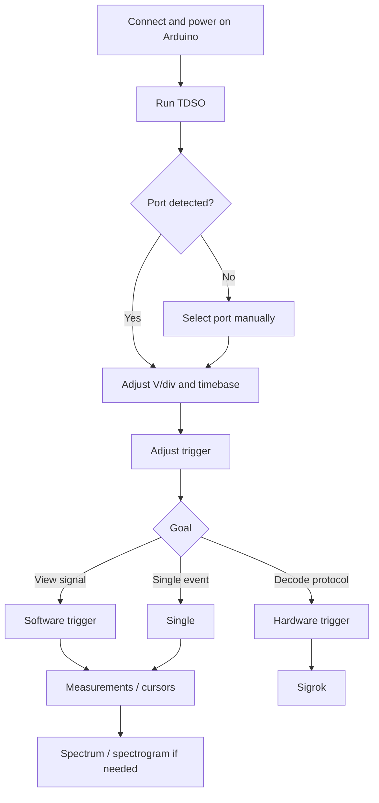

+++
date = '2026-11-08'
title = 'Oscilloscope v2'
description = 'OSCAR and OSCARET: digital oscilloscopes built with Arduino, Tcl/Tk, and simple hardware to explore signal acquisition, processing, and analysis.'
draft = false
+++

{}
Since completing the OSCAR and OSCARET project in September 2026 and publishing the book **Arduino, Tcl/Tk osciloscopio**, the project has taken several important steps forward:

- addition of a spectrogram
- integration with Sigrok

Several visual themes have also been added, and the interface has been internationalized.
{}

{}Arduino UNO{}
{}Tcl/Tk{}
{}Signal acquisition{}
{}DHT{}
{}CA3306{}
{}DSO183{}


I had originally planned to wait until the second book was published before releasing this new version. In that book, we will build more powerful versions and hack several commercial oscilloscopes [^1]. However, I believe these new features already make OSCAR and OSCARET worth releasing now.

[^1]: Support for controlling the DSO112A is already available in [TDSO112A](https://sourceforge.net/projects/tdso112a/)

> [!WARNING]
> Here you will find information about TDSO, the software I have developed, whose accompanying book has not yet been published. To learn the fundamentals (excluding the spectrogram and Sigrok integration), see [OSCAR y OSCARET]({})

{}Project page{}

{}View source code{}

## Visual themes

<div class="oscar-grid">
  <a href="../../img/skin-01.png" target="_blank">
    
  </a>
  <a href="../../img/skin-02.png" target="_blank">
    
  </a>
  <a href="../../img/skin-03.png" target="_blank">
    
  </a>
  <a href="../../img/skin-04.png" target="_blank">
    
  </a>
  <a href="../../img/skin-05.png" target="_blank">
    
  </a>
</div>

<style>
.oscar-grid {
  display: grid;
  grid-template-columns: repeat(auto-fit, minmax(150px, 1fr));
  gap: 15px;
  margin: 20px 0;
}
.oscar-grid img {
  width: 100%;
  height: auto;
  object-fit: cover;
  transition: transform 0.2s ease;
}
.oscar-grid img:hover {
  transform: scale(1.03);
}
</style>

---

## <i class="fas fa-microchip"></i> OSCAR: an Arduino UNO and two wires

The simplest way to get started is probably also the most surprising.

All you need is:

- an **Arduino UNO**
- a USB cable to connect it to your computer
- two wires to connect the signal you want to measure

**That is all.**

The ATmega328P’s built-in ADC digitizes the signal, while the computer displays and analyzes it.

In this way, an Arduino UNO becomes a small digital oscilloscope controlled from your PC.

{}
Arduino acquires the samples, while the computer provides the display, graphical interface, and much of the processing.

This keeps the hardware extremely simple by moving many functions into software.
{}

### What can you do?

Among other things, you can:

- display signals in real time
- export captures for later analysis
- measure voltages
- measure frequency and period
- use different trigger modes
- analyze acquired samples
- **examine the signal spectrum**
- **examine a signal spectrogram**
- **decode** various **protocols** (UART, DHT11, etc.) using **Sigrok**

Above all, you can experiment.

OSCAR is not intended to replace a professional oscilloscope. Its purpose is to show just how much can be achieved with very simple hardware and help you understand what really happens inside a digital measuring instrument.

### An important limitation

If you connect signals directly to an Arduino UNO, their voltage must remain approximately within this range:

```math
$$
0\text{ V} \leq V_{in} \leq 5\text{ V}
$$
```

Arduino cannot directly accept negative voltages or voltages above its supply voltage.

You must therefore be careful about which signals you connect.

Nevertheless, it can be a surprisingly useful tool for digital signals, sensors, small electronic circuits, PWM, suitably conditioned low-level audio, and many laboratory experiments.

If you do not have a development environment, I have provided a ready-to-run executable: [TDSO](https://sourceforge.net/projects/oscar-oscilloscope-arduino/files/tdso.exe/download).

### Going a little further

If you want to go a step further and measure AC/DC signals at different amplitudes, see [OSCAR y OSCARET]({}).

---

## TDSO user guide with OSCAR

[](https://youtu.be/Jz-yTQK0qPk)

---

## 1. Getting started

### 1.1. Connect the Arduino UNO R3 to your computer

Connect the Arduino UNO via USB and power up the oscilloscope. Upload the [firmware](https://github.com/hykrion/arduino-tcl-tk/tree/main/tdso/arduino) using the Arduino IDE.

The original firmware uses a serial connection at **115200 bit/s, 8-N-1**.

### 1.2. Run TDSO

Launch the TDSO executable.

The program **automatically detects the serial port of genuine Arduino boards** and starts communicating without any configuration. If you are using a clone, you will need to specify the serial port manually by editing `session.ini`. 

> [!TIP]
> The program is designed for use with **a genuine Arduino UNO**.
>
> You can also use a clone, but you must specify its serial port in `session.ini`, for example `COM8`.
>
> I recommend using a genuine Arduino UNO because, in my experience, clones can have serial communication issues and may stop sending data to the program. I have never encountered that problem with a genuine board.

> [!WARNING]
> The screenshots show a prototype with more capabilities than OSCAR. The functionality demonstrated is exactly the same.


## 2. Adjusting the signal display

Before taking measurements, adjust the vertical scale and timebase so that the signal occupies a substantial portion of the display.

As a rule of thumb:

- adjust **V/div** to make good use of the available height
- adjust the **timebase** to display several periods of the signal
- select **AC or DC** depending on the signal you want to observe
- configure the trigger to obtain a stable waveform

The demonstration shows a signal of approximately **10 kHz and 2 V**.


## 3. Interface language and appearance

TDSO lets you change the **language** and choose from different **visual themes**.

These settings do not affect data acquisition, but they let you tailor the interface to your preferences and make it easier to use in educational or laboratory settings.


## 4. Automatic measurements

TDSO can automatically calculate several properties of the acquired signal, including its **frequency**.

For reliable automatic measurements, the acquisition must contain enough information about the signal.

> [!IMPORTANT]
> An unsuitable timebase or sampling rate can cause measurement errors. If the signal appears overly compressed or too few samples are captured per period, review the acquisition settings.

In the demonstration, TDSO correctly measures a frequency close to **10 kHz**.


## 5. Triggering: hardware and software

For *everyday* use of OSCAR, the **Auto** trigger mode (software triggering) is generally the best choice. However, decoding protocols with **Sigrok** requires the **Normal** trigger mode (firmware-based triggering).

### 5.1. Auto, Normal, and Single modes

You can choose different trigger modes depending on the type of capture.

| Mode | Recommended use |
|---|---|
| **Auto** | General observation and continuous operation. |
| **Normal** | Capture only when the trigger condition is met. |
| **Single** | Capture a single event and stop acquisition. |

**Single** mode is especially useful for precise manual measurements or examining a particular event.

## 6. Cursors and manual measurements

When an automatic measurement is not enough, or you want to verify it manually, TDSO provides measurement cursors.

You can move the cursors with the **mouse** and fine-tune their positions using the **arrow keys**.

This lets you measure time intervals and calculate a signal’s frequency manually.

For example, if the measured period is approximately:


```math
$$
T = 100\ \mu\text{s}
$$
```

then the frequency is:


```math
$$
f = \frac{1}{T} = 10\ \text{kHz}
$$
```


## 7. Spectrum analyzer

TDSO includes a **spectrum** view that shows the frequency content of a signal.

This tool is particularly useful for:

- identifying the fundamental frequency
- detecting harmonics
- comparing the spectral purity of different signals
- studying noise and distortion
- investigating sampling-related effects


### 7.1. Choosing the right acquisition settings

When viewing the spectrum, avoid placing the fundamental frequency too close to the left edge of the graph.

The acquisition settings should provide sufficient resolution while keeping the frequency of interest within a useful part of the spectrum.

> [!CAUTION]
> Remember that the spectrum is limited by the Nyquist frequency. Components above half the sampling rate can cause **aliasing**.

## 8. Spectrum cursors

The spectrum view has its own cursors for precise analysis of frequency components.

In the demonstration:

- the **left mouse button** positions the first cursor
- the **right mouse button** positions the second cursor
- each cursor displays the **frequency** and **magnitude** of the selected component

Magnitude can be displayed in **dBFS**.

This makes it easy to identify the fundamental and its harmonics. For example, a square wave shows odd harmonics: the third, fifth, seventh, and so on.


## 9. Spectrogram

In addition to the conventional spectrum view, TDSO includes a **spectrogram**.

While a spectrum shows the frequency content of a single capture, a spectrogram shows how that content changes **over time**.

It is especially useful for signals whose spectral content changes over time.


## 10. Protocol decoding with Sigrok

One of TDSO’s most powerful features is its integration with **Sigrok** for decoding digital signals.

> [!IMPORTANT]
> To decode protocols with TDSO, you need to install **sigrok-cli**. Decoding DHT11 signals also requires a small modification to the AM230x decoder, explained below.

### 10.1. Installing sigrok-cli

Download and install **sigrok-cli** from the [official Sigrok downloads page](https://sigrok.org/wiki/Downloads). On Windows, choose the sigrok-cli installer for your system. You do not need to install PulseView to follow this guide.

Once installed, locate `sigrok-cli` and make sure TDSO is using that installation.

### 10.2. Adapting the DHT11/AM230x decoder

The original Sigrok AM230x decoder expects to see the entire beginning of the sensor’s start pulse. With OSCAR, however, acquisition may begin **after that pulse has already started** because of the limited buffer length and trigger position. As a result, the decoder may reject an otherwise valid frame.

To address this, the decoder has been modified to accept an initial pulse that is already low when sampling begins, **but only at the very start of the capture**. All other timing checks remain unchanged.

**Recommended installation procedure (Windows):**

1. Download the [modified AM230x decoder for TDSO](/arduino-tcl-tk/downloads/tdso/am230x/pd.py).
2. Locate the `sigrok-cli` installation directory and open `share\libsigrokdecode\decoders\am230x`.
3. Back up the original `pd.py` file, for example as `pd.py.bak`.
4. Copy the downloaded `pd.py` into that folder, replacing the original.
5. Restart TDSO if it was running, then test DHT11 decoding.

The relative path within the sigrok-cli installation is:

```text
sigrok-cli\share\libsigrokdecode\decoders\am230x\pd.py
```

> [!WARNING]
> Replace **only the AM230x decoder’s `pd.py` file**, not any other decoders. Keep the backup so you can restore the original. Reinstalling or updating sigrok-cli may overwrite the modification. This adaptation is provided for the version of sigrok-cli used with TDSO; compatibility with all future versions is not guaranteed.

If you prefer to review or apply the changes manually, the [`am230x.diff` diff file](/arduino-tcl-tk/downloads/tdso/am230x/am230x.diff) is also available. **Note:** this diff compares the modified file against the original (the reverse of a typical update patch), so installing the supplied `pd.py` directly is recommended.

### 10.3. When to use hardware triggering

For protocol decoding, it is important to capture the entire event at a predictable position in the buffer.

In this case, **hardware triggering** may be necessary because you need to capture the actual transmitted sequence, not merely display a stable waveform.

## 11. Example: decoding a DHT11

The DHT11 uses a simple digital protocol to transmit humidity and temperature readings.

In the demonstration, the sensor’s digital output is connected directly to the oscilloscope, and TDSO is configured to capture the frame.

### 11.1. Configure the capture

Set the following:

- **DC** coupling
- a suitable vertical scale
- a timebase long enough to capture the entire frame
- hardware triggering on the appropriate edge

DHT11 communication begins with a relatively long start pulse generated by the MCU, followed by the sensor’s response and the data bits.

### 11.2. Select the decoder

In the Sigrok section:

1. select the **DHT11** protocol
2. enable **real-time decoding**
3. inspect the annotations displayed over the waveform

TDSO can display numerous internal protocol annotations. If you only want the final results, select the results annotation: *am230x=results*. See the Sigrok documentation for more information.

This allows the interface to display only values such as:


## 12. Example: decoding serial communication

TDSO can also use Sigrok decoders to interpret serial communication.

Before decoding, make sure **the entire frame fits in the acquisition buffer**.

If it does not fit:

- increase the timebase
- change the trigger position within the buffer


Once the complete frame has been captured:

1. select the appropriate serial communication decoder
2. configure its parameters
3. enable real-time decoding
4. check the decoded values

In the demonstration, humidity and temperature readings are transmitted periodically.

## 13. Recommended workflow

For general use of an Arduino UNO R3 with TDSO, follow this workflow:



## 14. Troubleshooting




<ul>
  <li>Check the USB cable.</li>
  <li>Check that the operating system has created the serial port.</li>
  <li>Select that port manually in TDSO.</li>
</ul>





<ul>
  <li>Adjust the trigger level.</li>
  <li>Check the selected trigger edge.</li>
  <li>Try TDSO’s software trigger.</li>
  <li>Keep the limitations of hardware triggering in mind when using very fast timebases.</li>
</ul>





<ul>
  <li>Check the timebase.</li>
  <li>Try to display several complete periods.</li>
  <li>Check that the sampling rate is high enough.</li>
  <li>Verify the result using manual cursors.</li>
</ul>





<ul>
  <li>Increase the timebase.</li>
  <li>Move the trigger position toward the beginning of the buffer, for example to 1/8.</li>
  <li>Check that the capture includes everything from the trigger edge to the end of the frame.</li>
</ul>



## 15. Summary

TDSO turns an Arduino UNO R3 into a far more versatile instrument than its original interface alone would allow. Its most useful features include:

- oscilloscope control from a PC
- automatic serial port detection
- software triggering
- Auto, Normal, and Single modes
- cursors and manual measurements
- automatic measurements
- spectrum analyzer
- spectrum cursors with frequency and dBFS readouts
- spectrogram
- integration with Sigrok
- protocol decoding
- control over the trigger position within the buffer

Once you have mastered the basic controls, the spectrum, spectrogram, and decoding features make **TDSO + OSCAR** a particularly useful platform for learning, laboratory work, and analyzing small electronic systems.

---

### Resources

- [Sigrok: official downloads](https://sigrok.org/wiki/Downloads)
- [Modified AM230x decoder for TDSO](/arduino-tcl-tk/downloads/tdso/am230x/pd.py)
