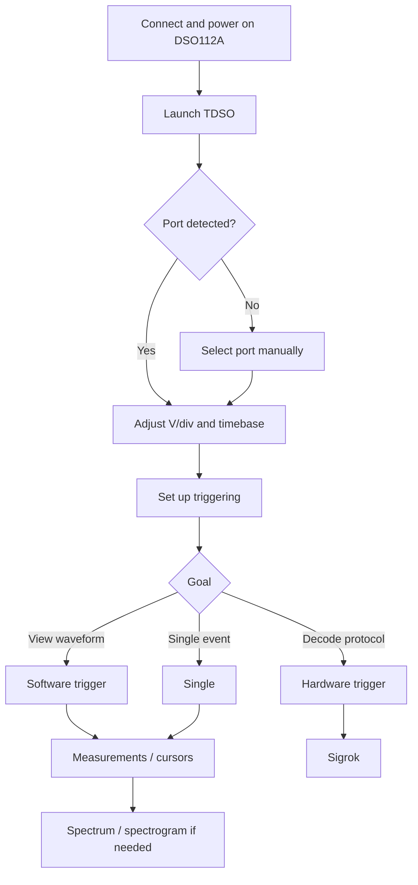

TDSO lets you control the **JYE Tech DSO112A** from your computer, significantly extending what this compact oscilloscope can do. It offers a more convenient waveform display, automatic and manual measurements, software triggering, spectrum analysis, spectrograms, and protocol decoding.


> [!INFO]
> This guide explains **how to use TDSO with the DSO112A**. It is not intended to replace the oscilloscope's own user manual.

## 1. Getting started

### 1.1. Connect the DSO112A to your computer

Connect the DSO112A via USB and switch it on. The DSO112A provides a serial interface over USB, which TDSO uses to communicate with the instrument.

The original firmware uses **115200 bit/s, 8-N-1** for serial communication.

### 1.2. Launch TDSO

Run the TDSO executable.

Normally, the program **automatically detects the serial port** used by the DSO112A and starts communicating with it without any manual setup.

> [!TIP]
> If automatic detection fails, open the communication settings in TDSO and manually select the serial port assigned to the DSO112A.


## 2. Adjusting the waveform display

Before taking measurements, adjust the vertical scale and timebase so that the waveform makes good use of the available screen space.

As a general rule:

- adjust **V/div** to make good use of the display height;
- adjust the **timebase** to show several cycles of the signal;
- choose **AC or DC coupling**, depending on the signal you want to examine;
- set up the trigger to obtain a stable waveform.

The demonstration uses a signal of approximately **10 kHz and 2 V**.


## 3. Language and appearance

TDSO lets you change the **interface language** and choose from several **visual themes**.

These settings do not affect data acquisition, but they make the interface more comfortable to use and easier to adapt to educational or laboratory environments.


## 4. Automatic measurements

TDSO can automatically calculate several properties of the acquired waveform, including its **frequency**.

For reliable automatic measurements, the acquisition must contain enough useful information about the signal.

> [!IMPORTANT]
> An unsuitable timebase or sampling rate can lead to measurement errors. If the waveform is heavily compressed or there are too few samples per cycle, review your acquisition settings.

In the demonstration, TDSO correctly measures a frequency close to **10 kHz**.


## 5. Triggering: hardware and software

Triggering is one of the most important aspects of working with the DSO112A.

### 5.1. DSO112A hardware triggering

The DSO112A has its own hardware trigger, but it has limitations that become particularly noticeable at very fast timebase settings.

In the demonstration, hardware triggering works at **10 µs/div**, but becomes unreliable at faster settings such as **5, 2, or 1 µs/div**.

### 5.2. TDSO software triggering

To work around these limitations, TDSO provides **software triggering**.

This can stabilize waveforms in situations where the DSO112A firmware's hardware trigger does not behave as expected.

> [!TIP]
> For general waveform viewing, try software triggering if hardware triggering cannot keep the waveform stable.


### 5.3. Auto, Normal, and Single modes

Different trigger modes are available depending on the type of acquisition you need.

| Mode | Recommended use |
|---|---|
| **Auto** | General waveform viewing and continuous operation. |
| **Normal** | Acquire only when the trigger condition is met. |
| **Single** | Capture one event and stop acquisition. |

**Single** mode is especially useful for accurate manual measurements or examining a specific event.

## 6. Cursors and manual measurements

When an automatic measurement is not enough, or when you want to verify it yourself, TDSO provides measurement cursors.

You can drag the cursors with the mouse, then fine-tune their positions using the **arrow keys**.

This lets you measure time intervals and calculate a signal's frequency manually.

For example, if the measured period is approximately:

```math
$$
T = 100\ \mu\text{s}
$$
```

the frequency is:

```math
$$
f = \frac{1}{T} = 10\ \text{kHz}
$$
```


## 7. Spectrum analyzer

TDSO includes a **spectrum view** that shows the frequency content of the acquired signal.

It is particularly useful for:

- identifying the fundamental frequency;
- detecting harmonics;
- comparing how clean different signals are;
- examining noise and distortion;
- investigating sampling-related effects.


### 7.1. Choosing suitable acquisition settings

When viewing the spectrum, avoid placing the fundamental frequency too close to the left edge of the graph.

The acquisition should provide enough frequency resolution while keeping the frequency of interest in a useful part of the spectrum.

> [!CAUTION]
> Remember that the spectrum is limited by the Nyquist frequency. Frequency components above half the sampling rate can cause **aliasing**.

## 8. Spectrum cursors

The spectrum view has its own cursors for examining individual frequency components more precisely.

In the demonstration:

- **left-click** to place the first cursor;
- **right-click** to place the second cursor;
- each cursor displays the selected component's **frequency** and **magnitude**.

Magnitude can be displayed in **dBFS**.

This makes it easy to identify the fundamental frequency and its harmonics. For example, the spectrum of a square wave can reveal the odd harmonics: the fundamental, third, fifth, seventh, and so on.


## 9. Spectrogram

In addition to the conventional spectrum display, TDSO includes a **spectrogram**.

While a spectrum shows the frequency content of a single acquisition, a spectrogram shows **how that content changes over time**.

It is especially useful for signals whose spectral content is not constant.

**Suggested GIF:** use a signal with a changing frequency, or switch between two frequencies, to clearly show the spectral bands moving.


## 10. Protocol decoding with sigrok

One of TDSO's most powerful features is its integration with **sigrok**, which can decode digital signals captured by the DSO112A.

> [!IMPORTANT]
> To use protocol decoding in TDSO, you must install **sigrok-cli**. Decoding DHT11 signals also requires a small modification to the AM230x decoder, as explained below.

### 10.1. Installing sigrok-cli

Download and install **sigrok-cli** from the [official sigrok downloads page](https://sigrok.org/wiki/Downloads). On Windows, choose the appropriate sigrok-cli installer for your system. You do not need to install PulseView to follow this guide.

After installation, locate `sigrok-cli` and make sure TDSO is configured to use that installation.

### 10.2. Modifying the DHT11/AM230x decoder

The original sigrok AM230x decoder expects to see the complete start pulse. However, because of the DSO112A's limited acquisition buffer and trigger position, a capture may begin **after that pulse has already started**. In this situation, the decoder may reject an otherwise valid data frame.

To address this, the decoder has been modified to accept an initial pulse that is already low when sampling begins, **but only at the very start of the capture**. All other timing checks remain in place.

**Recommended installation (Windows):**

1. Download the [modified AM230x decoder for TDSO](/arduino-tcl-tk/downloads/tdso/am230x/pd.py).
2. Find your `sigrok-cli` installation directory and open `share\libsigrokdecode\decoders\am230x`.
3. Back up the original `pd.py` file, for example as `pd.py.bak`.
4. Copy the downloaded `pd.py` into that directory, replacing the original file.
5. Restart TDSO if it is running, then test DHT11 decoding.

The path relative to the sigrok-cli installation directory is:

```text
sigrok-cli\share\libsigrokdecode\decoders\am230x\pd.py
```

> [!WARNING]
> Replace **only the `pd.py` file belonging to the AM230x decoder**. Do not modify other decoders. Keep a backup of the original so you can restore it if necessary. Reinstalling or updating sigrok-cli may overwrite your changes. This modification is provided for the sigrok-cli version used with TDSO; compatibility with future versions is not guaranteed.

If you would rather review or apply the changes manually, the [`am230x.diff` patch file](/arduino-tcl-tk/downloads/tdso/am230x/am230x.diff) is also available. **Note:** the supplied diff compares the modified file against the original (the reverse of a typical update patch). For this reason, installing the supplied `pd.py` directly is recommended.

### 10.3. When to use hardware triggering

For protocol decoding, it is important to capture the complete event at a predictable position within the acquisition buffer.

Hardware triggering may therefore be necessary: the goal is to capture the transmitted sequence at the right moment, rather than merely display a stable waveform.

## 11. Example: decoding a DHT11 sensor

The DHT11 uses a simple digital protocol to transmit humidity and temperature readings.

In the demonstration, the sensor's digital output is connected directly to the oscilloscope input, and TDSO is configured to capture the data frame.

### 11.1. Set up the acquisition

Configure the following:

- **DC coupling**;
- an appropriate vertical scale;
- a timebase long enough to capture the data frame;
- hardware triggering on the appropriate edge.

DHT11 communication begins with a relatively long start pulse generated by the microcontroller (MCU), followed by the sensor's response and the data bits.

### 11.2. Select the decoder

In the sigrok section of TDSO:

1. select the **DHT11** protocol;
2. enable **live decoding**;
3. examine the annotations displayed on the waveform.

TDSO can show many annotations describing the protocol's internal steps. If you only need the final values, select the results annotation row.

This lets the interface display just the relevant readings, such as:


## 12. Example: decoding serial communication

TDSO can also use sigrok decoders to interpret serial communications.

Before decoding, make sure **the complete data frame fits inside the acquisition buffer**.

If it does not:

- increase the timebase setting;
- move the trigger position within the buffer.

The DSO112A allows the trigger position to be adjusted within the capture buffer. For example, moving it from the center to **1/8 of the buffer** can leave more samples available after the trigger event.


Once the entire frame has been captured:

1. select the appropriate serial protocol decoder;
2. configure its parameters;
3. enable live decoding;
4. check the decoded values.

In the demonstration, humidity and temperature readings are transmitted periodically.

## 13. Pausing acquisition without losing control

TDSO lets you **pause waveform acquisition** while retaining control of the oscilloscope.

This is particularly useful if the hardware trigger gets stuck in an undesirable state.

While acquisition is paused:

- the waveform display stops updating;
- the DSO112A remains connected;
- you can still change the instrument's settings.


## 14. Hardware trigger recommendation

The DSO112A's hardware trigger can sometimes get stuck, particularly in **Normal** mode.

Unless you specifically need another mode, it is therefore best to leave the hardware trigger set to **Auto**.

TDSO attempts to return the trigger to a safe state automatically when you close the program.

> [!WARNING]
> If the DSO112A appears to have become unresponsive, first pause acquisition in TDSO, then switch the hardware trigger to **Auto**.

## 15. Recommended workflow

For general use of the DSO112A with TDSO, the following workflow is a good starting point:



## 16. Troubleshooting



<ul>
  <li>Make sure the DSO112A is powered on.</li>
  <li>Check the USB cable.</li>
  <li>Check that your operating system has assigned a serial port.</li>
  <li>Select that port manually in TDSO.</li>
</ul>





<ul>
  <li>Adjust the trigger level.</li>
  <li>Check the selected trigger edge.</li>
  <li>Try TDSO's software trigger.</li>
  <li>Remember the limitations of hardware triggering at very fast timebase settings.</li>
</ul>





<ul>
  <li>Check the timebase.</li>
  <li>Try displaying several complete cycles.</li>
  <li>Make sure the sampling rate is high enough.</li>
  <li>Verify the result using the manual cursors.</li>
</ul>





<ul>
  <li>Increase the timebase setting.</li>
  <li>Move the trigger position towards the beginning of the buffer, for example to 1/8.</li>
  <li>Make sure the capture includes the entire frame, from the trigger edge to its end.</li>
</ul>





<ul>
  <li>Click <strong>Pause</strong> in TDSO.</li>
  <li>Switch the hardware trigger mode to <strong>Auto</strong>.</li>
  <li>Resume acquisition.</li>
</ul>



## 17. Summary

TDSO makes the DSO112A a much more versatile instrument than its built-in interface alone would allow. Its most useful features include:

- controlling the oscilloscope from a PC;
- automatic serial port detection;
- software triggering;
- Auto, Normal, and Single trigger modes;
- cursors and manual measurements;
- automatic measurements;
- spectrum analysis;
- spectrum cursors with frequency and dBFS readouts;
- spectrogram display;
- sigrok integration;
- protocol decoding;
- adjustable trigger position within the acquisition buffer.

Once you are familiar with the basic controls, features such as spectrum analysis, spectrograms, and protocol decoding make **TDSO + DSO112A** a particularly useful setup for learning, lab work, and experimenting with small electronic systems.

---

### Resources

- [sigrok: official downloads](https://sigrok.org/wiki/Downloads)
- [Modified AM230x decoder for TDSO](/arduino-tcl-tk/downloads/tdso/am230x/pd.py)
- [JYE Tech – DSO112A](https://jyetech.com/dso-coral-112a-oscilloscope/)
- [Official DSO112A user manual](https://jyetech.com/wp-content/uploads/2019/01/dso112a-user-manual.pdf)
