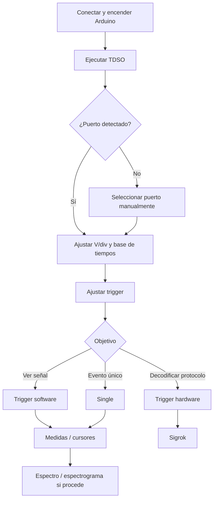

+++
date = '2026-11-08'
title = 'Osciloscopio v2'
description = 'OSCAR y OSCARET: osciloscopios digitales construidos con Arduino, Tcl/Tk y hardware sencillo para aprender adquisición, procesamiento y análisis de señales.'
draft = false
+++

{}
Desde que terminé el proyecto de OSCAR y OSCARET en septiembre de 2026 y la publicación del libro **Arduino, Tcl/Tk osciloscopio**, el proyecto ha dado varios pasos importantes:

- creación de un espectrograma
- integración con Sigrok

También se han creado diferentes temas visuales y se ha internacionalizado su contenido.
{}

{}Arduino UNO{}
{}Tcl/Tk{}
{}Adquisición de señales{}
{}DHT{}
{}CA3306{}
{}DSO183{}


De hecho, la idea era esperar hasta la publicación del segundo libro, donde crearemos otras versiones más potentes y donde hackearemos diferentes versiones de osciloscopios comerciales [^1], antes de sacar la nueva versión. Pero creo que publicar ya mismo una versión de OSCAR y OSCARET con estas características añade suficiente valor.

[^1]: Ya está disponible el control del DSO112A en [TDSO112A](https://sourceforge.net/projects/tdso112a/)

> [!WARNING]
> Aquí encontrarás información sobre el software que he desarrollado, TDSO, y del que aún no he publicado el libro. Si quieres aprender las bases del funcionamiento (excluyendo espectrograma e integración con Sigrok), puedes consultar [OSCAR y OSCARET]()

{}Página del proyecto{}

{}Ver código fuente{}

## Diferentes temas

<div class="oscar-grid">
  <a href="../../img/skin-01.png" target="_blank">
    
  </a>
  <a href="../../img/skin-02.png" target="_blank">
    
  </a>
  <a href="../../img/skin-03.png" target="_blank">
    
  </a>
  <a href="../../img/skin-04.png" target="_blank">
    
  </a>
  <a href="../../img/skin-05.png" target="_blank">
    
  </a>
</div>

<style>
.oscar-grid {
  display: grid;
  grid-template-columns: repeat(auto-fit, minmax(150px, 1fr));
  gap: 15px;
  margin: 20px 0;
}
.oscar-grid img {
  width: 100%;
  height: auto;
  object-fit: cover;
  transition: transform 0.2s ease;
}
.oscar-grid img:hover {
  transform: scale(1.03);
}
</style>

---

## <i class="fas fa-microchip"></i> OSCAR: un Arduino UNO y dos cables

La forma más sencilla de empezar es, probablemente, también la más sorprendente.

Necesitas:

- un **Arduino UNO**
- un cable USB para conectarlo al ordenador
- dos cables para conectar la señal que quieres medir

**Nada más.**

El convertidor ADC del propio ATmega328P se utiliza para digitalizar la señal y el ordenador se encarga de visualizarla y analizarla.

De esta forma, un Arduino UNO puede transformarse en un pequeño osciloscopio digital controlado desde el PC.

{}
Arduino se ocupa de adquirir las muestras y el ordenador aporta la pantalla, la interfaz gráfica y buena parte del procesamiento.

Eso permite mantener el hardware extremadamente sencillo y trasladar muchas funciones al software.
{}

### ¿Qué puedes hacer?

Entre otras cosas, puedes:

- visualizar señales en tiempo real
- exportar las capturas para analizarlas posteriormente
- medir tensiones
- medir frecuencia y periodo
- utilizar distintos modos de disparo
- analizar las muestras adquiridas
- **estudiar el espectro** de la señal
- **estudiar el espectrograma** de una señal
- **decodificar** diferentes tipos de **protocolos** (UART, DHT11...) gracias a **Sigrok**

Y, sobre todo, puedes experimentar.

OSCAR no pretende sustituir a un osciloscopio profesional. Su objetivo es demostrar cuánto puede hacerse con hardware extremadamente sencillo y permitir entender qué ocurre realmente dentro de un instrumento de medida digital.

### Una limitación importante

Si utilizas directamente Arduino UNO, las señales deben encontrarse aproximadamente dentro del intervalo:

```math
$$
0\text{ V} \leq V_{in} \leq 5\text{ V}
$$
```

Arduino no está preparado para recibir directamente tensiones negativas ni tensiones superiores a su alimentación.

Esto significa que hay que tener cuidado con las señales que se conectan.

A cambio, para señales digitales, sensores, pequeños circuitos electrónicos, PWM, audio de bajo nivel acondicionado adecuadamente y muchas experiencias de laboratorio, puede convertirse en una herramienta sorprendentemente útil.

Si no dispones de entorno de desarrollo, he creado un ejecutable para que también puedas utilizarlo: [TDSO](https://sourceforge.net/projects/oscar-oscilloscope-arduino/files/tdso.exe/download).

### Ir un poco más allá

Si quieres ir un poco más allá y medir señales AC/DC con diferentes amplitudes, consulta [OSCAR y OSCARET]().

---

## Manual de TDSO con OSCAR

[](https://youtu.be/bjNNAfSquWY)

---

## 1. Puesta en marcha

### 1.1. Conecta Arduino UNO R3 al ordenador

Conecta el Arduino UNO mediante USB y enciende el osciloscopio. Graba el [firmware](https://github.com/hykrion/arduino-tcl-tk/tree/main/tdso/arduino) mediante el IDE.

El firmware original trabaja con el puerto serie a **115200 bit/s, 8-N-1**.

### 1.2. Ejecuta TDSO

Abre el ejecutable de TDSO.

El programa **detecta automáticamente el puerto serie de los Arduino originales** y comienza la comunicación sin necesidad de configurar nada. Si estás trabajando con un clon, tendrás que indicar el puerto serie de forma manual modificando el fichero `session.ini`. 

> [!TIP]
> El programa está pensado para usarlo con **un Arduino UNO original**.
>
> Si tienes un clon, también puedes usarlo, pero tendrás que indicar tu puerto serie en el fichero `session.ini`. Por ejemplo: `COM8`.
>
> Yo recomiendo utilizar Arduino UNO original porque los clones tienden a fallar en su comunicación serie y pueden llegar a dejar de enviar datos al programa. Con el original nunca he tenido ese problema.

> [!WARNING]
> Las capturas mostradas son de un prototipo con más capacidad que OSCAR. La funcionalidad es exactamente la misma.


## 2. Ajustar la señal

Antes de realizar medidas, conviene adaptar la escala vertical y la base de tiempos para que la señal ocupe una parte significativa de la pantalla.

Como regla práctica:

- ajusta **V/div** para aprovechar bien la altura disponible
- ajusta la **base de tiempos** para ver varios periodos de la señal
- selecciona **AC o DC** según la señal que quieras observar
- configura el trigger para obtener una imagen estable

En el ejemplo utilizado durante la demostración, se observa una señal de aproximadamente **10 kHz y 2 V**.


## 3. Idioma y aspecto de la interfaz

TDSO permite cambiar el **idioma** y utilizar distintos **temas visuales**.

Esto no afecta a la adquisición de datos, pero permite adaptar la interfaz a las preferencias del usuario y facilita su utilización en entornos educativos o de laboratorio.


## 4. Medidas automáticas

TDSO puede calcular automáticamente distintas magnitudes de la señal adquirida. Entre ellas se encuentra la **frecuencia**.

Para que las medidas automáticas sean fiables, es importante que la adquisición contenga una cantidad razonable de información sobre la señal.

> [!IMPORTANT]
> Una base de tiempos o una frecuencia de muestreo inadecuadas pueden producir errores de medida. Si la señal aparece excesivamente comprimida o apenas se incluyen muestras suficientes por periodo, revisa la configuración de adquisición.

En el ejemplo de la demostración, TDSO obtiene correctamente una frecuencia próxima a **10 kHz**.


## 5. Trigger: hardware y software

Para el uso *normal* de OSCAR, lo mejor es utilizar siempre el trigger **Auto** (un trigger software), pero, para la decodificación de diferentes protocolos mediante **Sigrok**, es imprescindible utilizar el trigger **Normal** (un trigger firmware).

### 5.1. Modos Auto, Normal y Single

Según el tipo de captura puedes utilizar distintos modos de trigger.

| Modo | Uso recomendado |
|---|---|
| **Auto** | Observación general y funcionamiento continuo. |
| **Normal** | Capturar únicamente cuando se cumple la condición de trigger. |
| **Single** | Capturar un único evento y detener la adquisición. |

Para medidas manuales precisas o para estudiar un evento concreto, **Single** resulta especialmente útil.

## 6. Cursores y medidas manuales

Cuando una medida automática no sea suficiente o quieras comprobarla manualmente, TDSO dispone de cursores.

Los cursores pueden desplazarse con el **ratón** y, una vez aproximadamente colocados, ajustarse con mayor precisión mediante las **teclas de dirección**.

Esto permite medir intervalos de tiempo y calcular manualmente la frecuencia de una señal.

Por ejemplo, si el periodo medido es aproximadamente:


```math
$$
T = 100\ \mu\text{s}
$$
```

la frecuencia será:


```math
$$
f = \frac{1}{T} = 10\ \text{kHz}
$$
```


## 7. Analizador de espectro

TDSO incorpora una vista de **espectro** que permite observar el contenido frecuencial de la señal.

Esta herramienta es especialmente útil para:

- localizar la frecuencia fundamental
- detectar armónicos
- comparar la limpieza de distintas señales
- estudiar ruido y distorsión
- comprobar fenómenos relacionados con el muestreo


### 7.1. Elegir correctamente la adquisición

En la visualización espectral, conviene que la frecuencia fundamental no quede excesivamente próxima al extremo izquierdo del gráfico.

Una adquisición adecuada debe proporcionar suficiente resolución y, al mismo tiempo, mantener la frecuencia de interés dentro de una zona útil del espectro.

> [!CAUTION]
> Recuerda que el espectro está limitado por la frecuencia de Nyquist. Las componentes por encima de la mitad de la frecuencia de muestreo pueden producir **aliasing**.

## 8. Cursores en el espectro

El espectro dispone de cursores propios para analizar con precisión sus componentes.

En la demostración:

- el **botón izquierdo** permite colocar el primer cursor
- el **botón derecho** permite colocar el segundo
- cada cursor muestra la **frecuencia** y la **magnitud** de la componente seleccionada

La magnitud puede mostrarse en **dBFS**.

Esto resulta muy práctico para localizar la fundamental y sus armónicos. En una señal cuadrada, por ejemplo, pueden apreciarse los armónicos impares: el tercero, el quinto, el séptimo, etc.


## 9. Espectrograma

Además del espectro convencional, TDSO dispone de **un espectrograma**.

Mientras que el espectro muestra el contenido frecuencial de una captura, el espectrograma permite observar cómo cambia ese contenido **a lo largo del tiempo**.

Es especialmente útil para señales cuyo espectro no permanece constante.


## 10. Decodificación de protocolos con Sigrok

Una de las funciones más potentes de TDSO es la integración con **Sigrok** para interpretar señales digitales.

> [!IMPORTANT]
> Para utilizar la decodificación de protocolos con TDSO necesitas instalar **sigrok-cli**. Además, la decodificación del DHT11 requiere una pequeña adaptación del decodificador AM230x que se explica a continuación.

### 10.1. Instalar sigrok-cli

Descarga e instala **sigrok-cli** desde la [página oficial de descargas de Sigrok](https://sigrok.org/wiki/Downloads). En Windows, elige el instalador de sigrok-cli apropiado para tu sistema. No es necesario instalar PulseView para seguir esta guía.

Una vez instalado, comprueba dónde se encuentra `sigrok-cli` y asegúrate de que TDSO utiliza esa instalación.

### 10.2. Adaptar el decodificador DHT11/AM230x

El decodificador AM230x original de Sigrok espera encontrar el comienzo completo de la señal de arranque del sensor. Sin embargo, en OSCAR la captura puede comenzar **cuando ese pulso ya ha empezado**, debido a la longitud limitada del buffer y a la posición de disparo. En ese caso, el decodificador puede rechazar una trama que, por lo demás, es válida.

Para resolverlo, se ha modificado el decodificador para que acepte, **únicamente al principio de la captura**, un pulso inicial que ya estaba en nivel bajo al comenzar el muestreo. El resto de las comprobaciones de temporización se mantienen.

**Instalación recomendada (Windows):**

1. Descarga el [decodificador AM230x modificado para TDSO](/arduino-tcl-tk/downloads/tdso/am230x/pd.py).
2. Localiza la carpeta de instalación de `sigrok-cli` y entra en `share\libsigrokdecode\decoders\am230x`.
3. Guarda una copia del archivo original `pd.py`, por ejemplo con el nombre `pd.py.bak`.
4. Copia el archivo descargado `pd.py` en esa carpeta y sustituye el original.
5. Reinicia TDSO si estaba abierto y prueba la decodificación del DHT11.

La ruta relativa dentro de la instalación de sigrok-cli es:

```text
sigrok-cli\share\libsigrokdecode\decoders\am230x\pd.py
```

> [!WARNING]
> Sustituye **solo el archivo `pd.py` del decodificador AM230x**, no otros decodificadores. Conserva la copia del original para poder restaurarlo. Una reinstalación o actualización de sigrok-cli puede sobrescribir la modificación. Esta adaptación se proporciona para la versión de sigrok-cli utilizada con TDSO; no se garantiza que funcione sin cambios con todas las versiones futuras.

Para quienes prefieran revisar o aplicar los cambios manualmente, también está disponible el [archivo de diferencias `am230x.diff`](/arduino-tcl-tk/downloads/tdso/am230x/am230x.diff). **Atención:** el diff adjunto está expresado comparando el archivo modificado con el original (sentido inverso al de un parche habitual de actualización); por eso se recomienda instalar directamente el `pd.py` suministrado.

### 10.3. Cuándo utilizar trigger hardware

Para decodificar protocolos, es importante capturar el evento completo en una posición predecible del buffer.

En este caso, puede ser necesario utilizar **trigger hardware**, ya que se quiere capturar exactamente la secuencia transmitida y no una señal simplemente estabilizada en pantalla.

## 11. Ejemplo: decodificar un DHT11

El DHT11 utiliza un protocolo digital sencillo para transmitir humedad y temperatura.

En la demostración, se conecta directamente la salida digital del sensor al osciloscopio y se configura TDSO para capturar la trama.

### 11.1. Ajusta la captura

Configura:

- acoplamiento **DC**
- escala vertical adecuada
- base de tiempos suficiente para contener la trama
- trigger hardware en el flanco apropiado

El comienzo de la comunicación del DHT11 contiene un pulso de inicio relativamente largo generado por la MCU, seguido por la respuesta del sensor y los bits de datos.

### 11.2. Selecciona el decodificador

En la sección de Sigrok:

1. selecciona el protocolo **DHT11**
2. activa la **decodificación en tiempo real**
3. observa las anotaciones generadas sobre la señal

TDSO puede mostrar numerosas anotaciones internas del protocolo. Si solo te interesan los resultados finales, selecciona la anotación de resultados: *am230x=results*. Consulta el manual de Sigrok para más información.

De esta forma la interfaz puede mostrar únicamente valores como:


## 12. Ejemplo: decodificación de puerto serie

TDSO también puede utilizar los decodificadores de Sigrok para interpretar una comunicación serie.

Antes de decodificarla, debes asegurarte de que **la trama completa cabe dentro del buffer de adquisición**.

Si no cabe:

- aumenta la base de tiempos
- modifica la posición del trigger dentro del buffer


Una vez capturada la trama completa:

1. selecciona el decodificador de comunicación serie correspondiente
2. configura sus parámetros
3. activa la decodificación en tiempo real
4. comprueba los valores obtenidos

En el ejemplo de la demostración, se transmiten valores de humedad y temperatura de forma periódica.

## 13. Flujo de trabajo recomendado

Para una utilización general de Arduino UNO R3 con TDSO, puedes seguir esta secuencia:



## 14. Problemas frecuentes




<ul>
  <li>Revisa el cable USB.</li>
  <li>Comprueba que el sistema operativo ha creado el puerto serie.</li>
  <li>Selecciona manualmente ese puerto desde TDSO.</li>
</ul>





<ul>
  <li>Ajusta el nivel de trigger.</li>
  <li>Comprueba el flanco seleccionado.</li>
  <li>Prueba el trigger software de TDSO.</li>
  <li>Si utilizas trigger hardware con bases de tiempo muy rápidas, recuerda sus limitaciones.</li>
</ul>





<ul>
  <li>Revisa la base de tiempos.</li>
  <li>Intenta visualizar varios periodos completos.</li>
  <li>Comprueba que la frecuencia de muestreo es suficiente.</li>
  <li>Verifica el resultado mediante cursores manuales.</li>
</ul>





<ul>
  <li>Aumenta la base de tiempos.</li>
  <li>Desplaza la posición del trigger hacia el principio del buffer, por ejemplo a 1/8.</li>
  <li>Comprueba que la captura contiene desde el flanco de disparo hasta el final de la trama.</li>
</ul>



## 15. Resumen

TDSO convierte un Arduino UNO R3 en una herramienta bastante más versátil de lo que permite su interfaz original. Las funciones más útiles son:

- control del osciloscopio desde el PC
- detección automática del puerto serie
- trigger por software
- modos Auto, Normal y Single
- cursores y medidas manuales
- medidas automáticas
- analizador de espectro
- cursores espectrales con lectura de frecuencia y dBFS
- espectrograma
- integración con Sigrok
- decodificación de protocolos
- control de la posición del trigger dentro del buffer

Una vez dominados los controles básicos, las funciones de espectro, espectrograma y decodificación convierten al conjunto **TDSO + OSCAR** en una plataforma especialmente interesante para el aprendizaje, el laboratorio y el análisis de pequeños sistemas electrónicos.

---

### Recursos

- [Sigrok: descargas oficiales](https://sigrok.org/wiki/Downloads)
- [Decodificador AM230x modificado para TDSO](/arduino-tcl-tk/downloads/tdso/am230x/pd.py)
