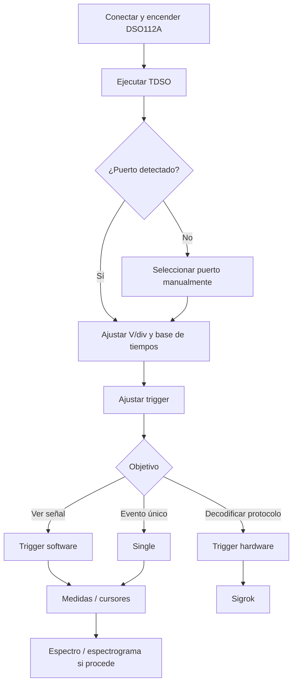

TDSO permite utilizar el **JYE Tech DSO112A** desde el ordenador y amplía de forma importante las posibilidades del pequeño osciloscopio: visualización cómoda de la señal, medidas automáticas y manuales, trigger por software, análisis de espectro, espectrograma y decodificación de protocolos.


> [!INFO]
> Esta página se centra en **cómo utilizar TDSO con el DSO112A**. No pretende sustituir al manual del propio osciloscopio.

## 1. Puesta en marcha

### 1.1. Conecta el DSO112A al ordenador

Conecta el DSO112A mediante USB y enciende el osciloscopio. El DSO112A dispone de una interfaz serie a través de USB, que TDSO utiliza para comunicarse con el equipo.

El firmware original trabaja con el puerto serie a **115200 bit/s, 8-N-1**.

### 1.2. Ejecuta TDSO

Abre el ejecutable de TDSO.

Normalmente el programa **detecta automáticamente el puerto serie** correspondiente al DSO112A y comienza la comunicación sin necesidad de configurar nada.

> [!TIP]
> Si la detección automática falla, abre la configuración de comunicaciones de TDSO y selecciona manualmente el puerto serie en el que aparece el DSO112A.


## 2. Ajustar la señal

Antes de realizar medidas, conviene adaptar la escala vertical y la base de tiempos para que la señal ocupe una parte significativa de la pantalla.

Como regla práctica:

- ajusta **V/div** para aprovechar bien la altura disponible;
- ajusta la **base de tiempos** para ver varios periodos de la señal;
- selecciona **AC o DC** según la señal que quieras observar;
- configura el trigger para obtener una imagen estable.

En el ejemplo utilizado durante la demostración se observa una señal de aproximadamente **10 kHz y 2 V**.


## 3. Idioma y aspecto de la interfaz

TDSO permite cambiar el **idioma** y utilizar distintos **temas visuales**.

Esto no afecta a la adquisición de datos, pero permite adaptar la interfaz a las preferencias del usuario y facilita su utilización en entornos educativos o de laboratorio.


## 4. Medidas automáticas

TDSO puede calcular automáticamente distintas magnitudes de la señal adquirida. Entre ellas se encuentra la **frecuencia**.

Para que las medidas automáticas sean fiables es importante que la adquisición contenga una cantidad razonable de información sobre la señal.

> [!IMPORTANT]
> Una base de tiempos o una frecuencia de muestreo inadecuadas pueden producir errores de medida. Si la señal aparece excesivamente comprimida o apenas se incluyen muestras suficientes por periodo, revisa la configuración de adquisición.

En el ejemplo de la demostración, TDSO obtiene correctamente una frecuencia próxima a **10 kHz**.


## 5. Trigger: hardware y software

El trigger es uno de los apartados más importantes al trabajar con el DSO112A.

### 5.1. Trigger hardware del DSO112A

El propio DSO112A dispone de trigger hardware. Sin embargo, presenta limitaciones especialmente visibles con determinadas bases de tiempo muy rápidas.

En la demostración puede observarse que el trigger hardware funciona a **10 µs/div**, pero deja de ser fiable al seleccionar bases de tiempo inferiores como **5, 2 o 1 µs/div**.

### 5.2. Trigger software de TDSO

Para compensar estas limitaciones, TDSO incorpora **trigger por software**.

Esto permite estabilizar señales en situaciones en las que el trigger del firmware del DSO112A no ofrece un resultado adecuado.

> [!TIP]
> Para visualización general de señales, prueba el trigger software cuando el trigger hardware no consiga mantener la forma de onda estable.


### 5.3. Modos Auto, Normal y Single

Según el tipo de captura puedes utilizar distintos modos de trigger.

| Modo | Uso recomendado |
|---|---|
| **Auto** | Observación general y funcionamiento continuo. |
| **Normal** | Capturar únicamente cuando se cumple la condición de trigger. |
| **Single** | Capturar un único evento y detener la adquisición. |

Para medidas manuales precisas o para estudiar un evento concreto, **Single** resulta especialmente útil.

## 6. Cursores y medidas manuales

Cuando una medida automática no sea suficiente o quieras comprobarla manualmente, TDSO dispone de cursores.

Los cursores pueden desplazarse con el ratón y, una vez aproximadamente colocados, ajustarse con mayor precisión mediante las **teclas de dirección**.

Esto permite medir intervalos de tiempo y calcular manualmente la frecuencia de una señal.

Por ejemplo, si el periodo medido es aproximadamente:


```math
$$
T = 100\ \mu\text{s}
$$
```

la frecuencia será:


```math
$$
f = \frac{1}{T} = 10\ \text{kHz}
$$
```


## 7. Analizador de espectro

TDSO incorpora una vista de **espectro** que permite observar el contenido frecuencial de la señal.

Esta herramienta es especialmente útil para:

- localizar la frecuencia fundamental;
- detectar armónicos;
- comparar la limpieza de distintas señales;
- estudiar ruido y distorsión;
- comprobar fenómenos relacionados con el muestreo.


### 7.1. Elegir correctamente la adquisición

En la visualización espectral conviene que la frecuencia fundamental no quede excesivamente próxima al extremo izquierdo del gráfico.

Una adquisición adecuada debe proporcionar suficiente resolución y, al mismo tiempo, mantener la frecuencia de interés dentro de una zona útil del espectro.

> [!CAUTION]
> Recuerda que el espectro está limitado por la frecuencia de Nyquist. Las componentes por encima de la mitad de la frecuencia de muestreo pueden producir **aliasing**.

## 8. Cursores en el espectro

El espectro dispone de cursores propios para analizar con precisión sus componentes.

En la demostración:

- el **botón izquierdo** permite colocar el primer cursor;
- el **botón derecho** permite colocar el segundo;
- cada cursor muestra la **frecuencia** y la **magnitud** de la componente seleccionada.

La magnitud puede mostrarse en **dBFS**.

Esto resulta muy práctico para localizar la fundamental y sus armónicos. En una señal cuadrada, por ejemplo, pueden apreciarse los armónicos impares correspondientes a la fundamental, tercer armónico, quinto, séptimo, etc.


## 9. Espectrograma

Además del espectro convencional, TDSO dispone de **espectrograma**.

Mientras que el espectro muestra el contenido frecuencial de una captura, el espectrograma permite observar cómo cambia ese contenido **a lo largo del tiempo**.

Es especialmente útil para señales cuyo espectro no permanece constante.


## 10. Decodificación de protocolos con sigrok

Una de las funciones más potentes de TDSO es la integración con **sigrok** para interpretar señales digitales capturadas por el DSO112A.

> [!IMPORTANT]
> Para utilizar la decodificación de protocolos con TDSO necesitas instalar **sigrok-cli**. Además, la decodificación del DHT11 requiere una pequeña adaptación del decodificador AM230x que se explica a continuación.

### 10.1. Instalar sigrok-cli

Descarga e instala **sigrok-cli** desde la [página oficial de descargas de sigrok](https://sigrok.org/wiki/Downloads). En Windows, elige el instalador de sigrok-cli apropiado para tu sistema, no es necesario instalar PulseView para seguir esta guía.

Una vez instalado, comprueba dónde se encuentra `sigrok-cli` y asegúrate de que TDSO utiliza esa instalación.

### 10.2. Adaptar el decodificador DHT11/AM230x

El decodificador AM230x original de sigrok espera encontrar el comienzo completo de la señal de arranque del sensor. Sin embargo, en el DSO112A la captura puede comenzar **cuando ese pulso ya ha empezado**, debido a la longitud limitada del buffer y a la posición de disparo. En ese caso, el decodificador puede rechazar una trama que, por lo demás, es válida.

Para resolverlo, se ha modificado el decodificador para que acepte, **únicamente al principio de la captura**, un pulso inicial que ya estaba en nivel bajo al comenzar el muestreo. El resto de las comprobaciones de temporización se mantienen.

**Instalación recomendada (Windows):**

1. Descarga el [decodificador AM230x modificado para TDSO](/arduino-tcl-tk/downloads/tdso/am230x/pd.py).
2. Localiza la carpeta de instalación de `sigrok-cli` y entra en `share\libsigrokdecode\decoders\am230x`.
3. Guarda una copia del archivo original `pd.py`, por ejemplo con el nombre `pd.py.bak`.
4. Copia el archivo descargado `pd.py` en esa carpeta y sustituye el original.
5. Reinicia TDSO si estaba abierto y prueba la decodificación del DHT11.

La ruta relativa dentro de la instalación de sigrok-cli es:

```text
sigrok-cli\share\libsigrokdecode\decoders\am230x\pd.py
```

> [!WARNING]
> Sustituye **solo el archivo `pd.py` del decodificador AM230x**, no otros decodificadores. Conserva la copia del original para poder restaurarlo. Una reinstalación o actualización de sigrok-cli puede sobrescribir la modificación. Esta adaptación se proporciona para la versión de sigrok-cli utilizada con TDSO; no se garantiza que funcione sin cambios con todas las versiones futuras.

Para quienes prefieran revisar o aplicar los cambios manualmente, también está disponible el [archivo de diferencias `am230x.diff`](/arduino-tcl-tk/downloads/tdso/am230x/am230x.diff). **Atención:** el diff adjunto está expresado comparando el archivo modificado con el original (sentido inverso al de un parche habitual de actualización); por eso se recomienda instalar directamente el `pd.py` suministrado.

### 10.3. Cuándo utilizar trigger hardware

Para decodificar protocolos es importante capturar el evento completo en una posición predecible del buffer.

En este caso puede ser necesario utilizar **trigger hardware**, ya que se quiere capturar exactamente la secuencia transmitida y no una señal simplemente estabilizada en pantalla.

## 11. Ejemplo: decodificar un DHT11

El DHT11 utiliza un protocolo digital sencillo para transmitir humedad y temperatura.

En la demostración se conecta directamente la salida digital del sensor al osciloscopio y se configura TDSO para capturar la trama.

### 11.1. Ajusta la captura

Configura:

- acoplamiento **DC**;
- escala vertical adecuada;
- base de tiempos suficiente para contener la trama;
- trigger hardware en el flanco apropiado.

El comienzo de la comunicación del DHT11 contiene un pulso de inicio relativamente largo generado por la MCU, seguido por la respuesta del sensor y los bits de datos.

### 11.2. Selecciona el decodificador

En la sección de sigrok:

1. selecciona el protocolo **DHT11**;
2. activa la **decodificación en tiempo real**;
3. observa las anotaciones generadas sobre la señal.

TDSO puede mostrar numerosas anotaciones internas del protocolo. Si solo te interesan los resultados finales, selecciona la anotación de resultados.

De esta forma la interfaz puede mostrar únicamente valores como:


## 12. Ejemplo: decodificación de puerto serie

TDSO también puede utilizar los decodificadores de sigrok para interpretar una comunicación serie.

Antes de decodificarla debes asegurarte de que **la trama completa cabe dentro del buffer de adquisición**.

Si no cabe:

- aumenta la base de tiempos;
- modifica la posición del trigger dentro del buffer.

El DSO112A permite situar el trigger en distintas posiciones de la memoria de captura. Por ejemplo, puede ser útil pasar de una posición centrada a **1/8 del buffer** para disponer de más muestras posteriores al disparo.


Una vez capturada la trama completa:

1. selecciona el decodificador de comunicación serie correspondiente;
2. configura sus parámetros;
3. activa la decodificación en tiempo real;
4. comprueba los valores obtenidos.

En el ejemplo de la demostración se transmiten valores de humedad y temperatura de forma periódica.

## 13. Pausar la adquisición sin perder el control

TDSO permite **pausar la recepción de formas de onda** manteniendo la posibilidad de controlar el osciloscopio.

Esta función resulta especialmente útil si el trigger hardware queda en un estado problemático.

Al pausar:

- se deja de actualizar la forma de onda;
- el DSO112A sigue conectado;
- todavía pueden modificarse parámetros del equipo.


## 14. Recomendación sobre el trigger hardware

El trigger hardware del DSO112A puede quedarse bloqueado en algunas situaciones, especialmente utilizando el modo **Normal**.

Por ello, cuando no necesites expresamente otro comportamiento, es recomendable dejar el trigger hardware en **Auto**.

TDSO intenta devolverlo automáticamente a un estado seguro cuando se cierra el programa.

> [!WARNING]
> Si el DSO112A parece haberse quedado bloqueado, pausa primero la adquisición desde TDSO y cambia el trigger hardware a **Auto**.

## 15. Flujo de trabajo recomendado

Para una utilización general del DSO112A con TDSO puedes seguir esta secuencia:



## 16. Problemas frecuentes




<ul>
  <li>Comprueba que el DSO112A está encendido.</li>
  <li>Revisa el cable USB.</li>
  <li>Comprueba que el sistema operativo ha creado el puerto serie.</li>
  <li>Selecciona manualmente ese puerto desde TDSO.</li>
</ul>





<ul>
  <li>Ajusta el nivel de trigger.</li>
  <li>Comprueba el flanco seleccionado.</li>
  <li>Prueba el trigger software de TDSO.</li>
  <li>Si utilizas trigger hardware con bases de tiempo muy rápidas, recuerda sus limitaciones.</li>
</ul>





<ul>
  <li>Revisa la base de tiempos.</li>
  <li>Intenta visualizar varios periodos completos.</li>
  <li>Comprueba que la frecuencia de muestreo es suficiente.</li>
  <li>Verifica el resultado mediante cursores manuales.</li>
</ul>





<ul>
  <li>Aumenta la base de tiempos.</li>
  <li>Desplaza la posición del trigger hacia el principio del buffer, por ejemplo a 1/8.</li>
  <li>Comprueba que la captura contiene desde el flanco de disparo hasta el final de la trama.</li>
</ul>





<ul>
  <li>Pulsa <strong>Pausa</strong> en TDSO.</li>
  <li>Cambia el modo del trigger hardware a <strong>Auto</strong>.</li>
  <li>Reanuda la adquisición.</li>
</ul>



## 17. Resumen

TDSO convierte al DSO112A en una herramienta bastante más versátil de lo que permite su interfaz original. Las funciones más útiles son:

- control del osciloscopio desde el PC;
- detección automática del puerto serie;
- trigger por software;
- modos Auto, Normal y Single;
- cursores y medidas manuales;
- medidas automáticas;
- analizador de espectro;
- cursores espectrales con lectura de frecuencia y dBFS;
- espectrograma;
- integración con sigrok;
- decodificación de protocolos;
- control de la posición del trigger dentro del buffer.

Una vez dominados los controles básicos, las funciones de espectro, espectrograma y decodificación convierten al conjunto **TDSO + DSO112A** en una plataforma especialmente interesante para aprendizaje, laboratorio y análisis de pequeños sistemas electrónicos.

---

### Recursos

- [sigrok: descargas oficiales](https://sigrok.org/wiki/Downloads)
- [Decodificador AM230x modificado para TDSO](/arduino-tcl-tk/downloads/tdso/am230x/pd.py)
- [JYE Tech - DSO112A](https://jyetech.com/dso-coral-112a-oscilloscope/)
- [Manual oficial del DSO112A](https://jyetech.com/wp-content/uploads/2019/01/dso112a-user-manual.pdf)
